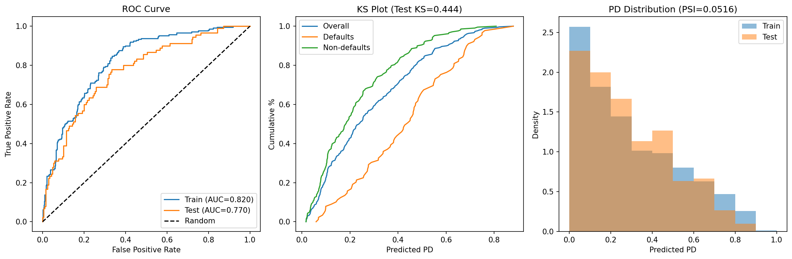

# Probability of Default (PD) Scorecard — German Credit Dataset

A logistic regression PD scorecard built on the [UCI German Credit dataset](https://archive.ics.uci.edu/ml/datasets/Statlog+(German+Credit+Data)) (1,000 applicants, 20 features). Demonstrates the full credit risk modeling pipeline: data prep, WoE/IV feature selection, model fitting, and validation.

> **Built for**: Citi Risk Model Development/Validation Analyst internship application

## Quick Start

```bash
pip install -r requirements.txt
python step2_data_prep.py
python step3_split.py
python step4_woe_iv.py
python step5_model.py
python step6_validation.py
python step7_sql.py
```

## Methodology

| Step | What | Script |
|------|------|--------|
| 1 | Download UCI German Credit (`german.data`) | Manual / see below |
| 2 | Define default flag (1→Good, 2→Bad), drop leakage columns | `step2_data_prep.py` |
| 3 | 70/30 stratified train/test split (seed=42) | `step3_split.py` |
| 4 | WoE binning + IV feature selection (threshold ≥ 0.02) | `step4_woe_iv.py` |
| 5 | Logistic regression on WoE-transformed features | `step5_model.py` |
| 6 | Validation: AUC, KS, Gini, PSI + plots | `step6_validation.py` |
| 7 | SQL analysis in SQLite (GROUP BY, CTE, window functions) | `step7_sql.py` |

**Dataset download** (no login required):
```
curl -o data/german.data https://archive.ics.uci.edu/ml/machine-learning-databases/statlog/german/german.data
```

## Feature Selection — Information Value

| Feature | IV | Strength |
|---------|------|----------|
| status_checking | 0.630 | Suspicious* |
| credit_history | 0.252 | Medium |
| savings | 0.221 | Medium |
| duration | 0.184 | Medium |
| property | 0.139 | Medium |
| employment | 0.139 | Medium |
| purpose | 0.129 | Medium |
| other_plans | 0.118 | Medium |
| housing | 0.103 | Medium |
| credit_amount | 0.064 | Weak |
| age | 0.047 | Weak |
| personal_status | 0.039 | Weak |
| installment_rate | 0.033 | Weak |
| other_debtors | 0.026 | Weak |
| job | 0.024 | Weak |
| ~~residence~~ | 0.001 | Dropped |
| ~~num_credits~~ | 0.001 | Dropped |
| ~~dependents~~ | 0.000 | Dropped |

**15 features selected**, 3 dropped (IV < 0.02).

\* `status_checking` IV > 0.5 is flagged as "suspicious" by standard rules, but this is a genuine strong predictor in the German Credit dataset — checking account status is the single best indicator of default risk.

## Validation Results

| Metric | Train | Test |
|--------|-------|------|
| **AUC** | 0.8199 | 0.7703 |
| **Gini** | 0.6398 | 0.5405 |
| **KS** | 0.5129 | 0.4444 |
| **PSI** | — | 0.0516 (Stable) |



## SQL Analysis Highlights

4 queries in [`sql/credit_risk_queries.sql`](sql/credit_risk_queries.sql):

1. **Default rate by checking account status** — negative balance → 49.3% default vs. no account → 11.7%
2. **Default rate by purpose × loan amount band** — high-amount education loans → 53.8% default
3. **Risk tier distribution (CTE)** — model calibration: predicted PD aligns with actual default rate across all 4 tiers
4. **Top-risk customers per segment (window functions)** — RANK() and NTILE() for within-segment risk ranking

## Limitations

1. **Small dataset**: Only 1,000 records (700 train / 300 test). Real scorecards use 50K–500K+ observations. Small samples increase coefficient instability and overfitting risk.
2. **High default rate**: 30% vs. real-world ~2–5%. This inflates discrimination metrics (AUC, KS) and means the model wouldn't transfer directly to a production portfolio.
3. **No out-of-time validation**: The dataset has no date column, so train/test is a random split, not a time-based split. Production models require out-of-time testing to detect concept drift.
4. **No challenger model**: Only logistic regression tested. A production workflow would compare against gradient boosting, random forest, etc.
5. **Fair lending concern**: `personal_status` encodes gender + marital status. A production model would require disparate impact analysis and potentially exclude this feature.
6. **No scorecard scaling**: Raw PD probabilities are output, not scaled scorecard points (e.g., 300–850 range).

## Project Structure

```
pd-scorecard/
├── data/
│   ├── german.data              # Raw UCI dataset
│   ├── german_clean.csv         # After data prep
│   ├── train.csv / test.csv     # Stratified split
│   ├── train_woe.csv / test_woe.csv  # WoE-transformed
│   ├── iv_table.csv             # Information Value results
│   ├── coefficients.csv         # Model coefficients
│   ├── validation_metrics.csv   # AUC, KS, Gini, PSI
│   └── german_credit.db         # SQLite database
├── sql/
│   └── credit_risk_queries.sql  # 4 credit risk SQL queries
├── notebooks/
│   └── pd_scorecard.ipynb       # Full pipeline notebook
├── step2_data_prep.py
├── step3_split.py
├── step4_woe_iv.py
├── step5_model.py
├── step6_validation.py
├── step7_sql.py
├── validation_plots.png
├── requirements.txt
└── README.md
```

## Tech Stack

Python 3.12 | pandas | NumPy | scikit-learn | matplotlib | SQLite

